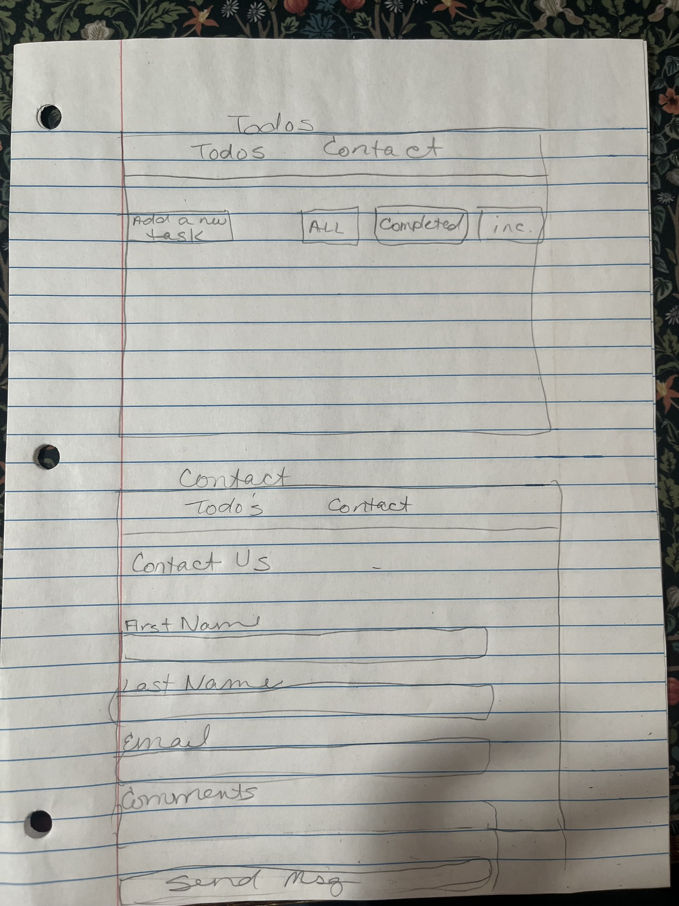
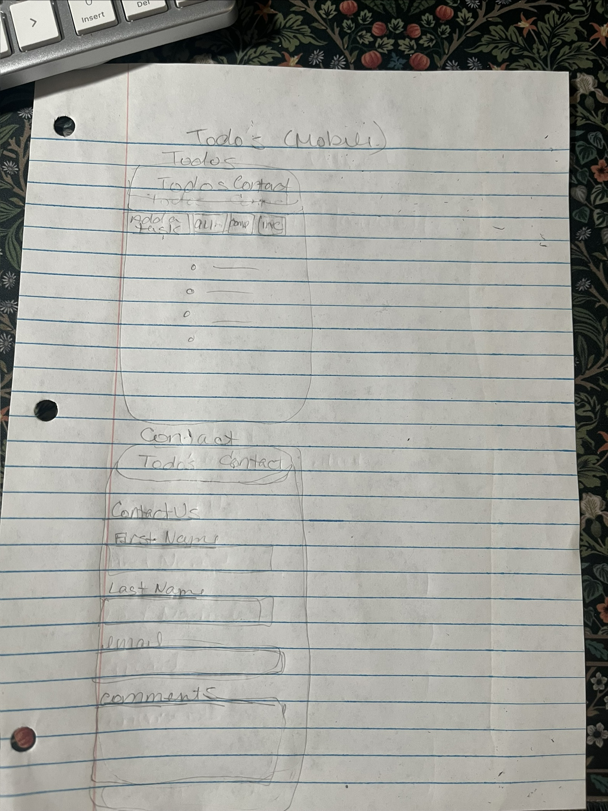

# Wireframes

Below are the hand-drawn wireframes for the application. Each drawing contains both the `/todos` view and the `/contact` view.

## Desktop View (Todos & Contact)

## Mobile View (Todos & Contact)

### Mobile Layout Behavior
On mobile screens, both views stack vertically:
- Title stacks above nav links
- Nav links stack vertically
- Add form: input above button
- Filter buttons stack vertically
- Task rows stack: text above buttons
- Contact form: full-width fields, button full-width